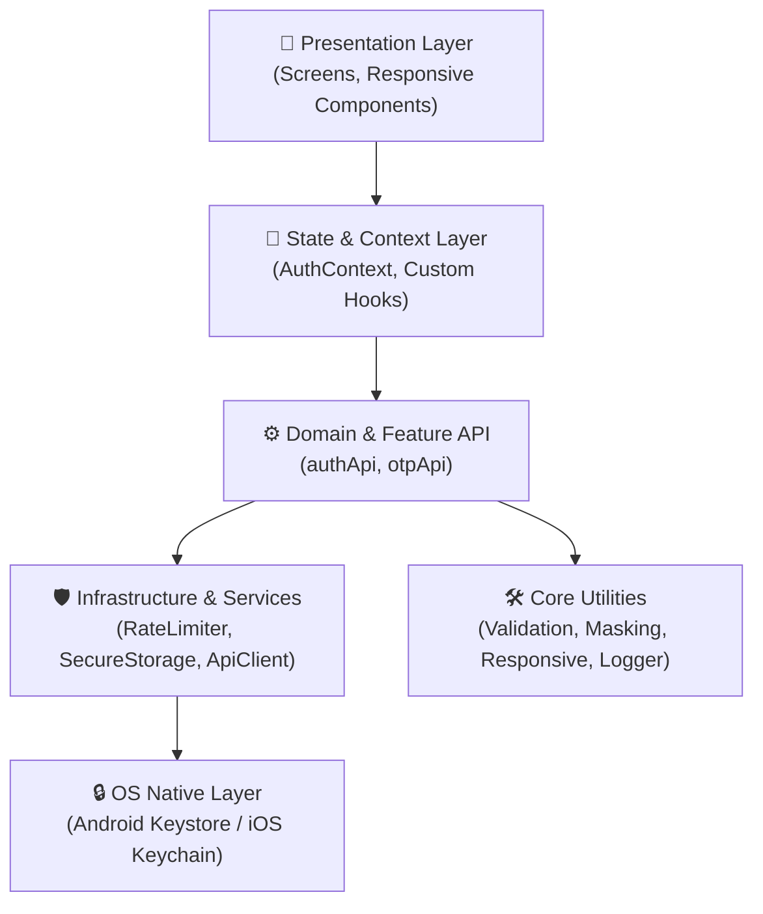
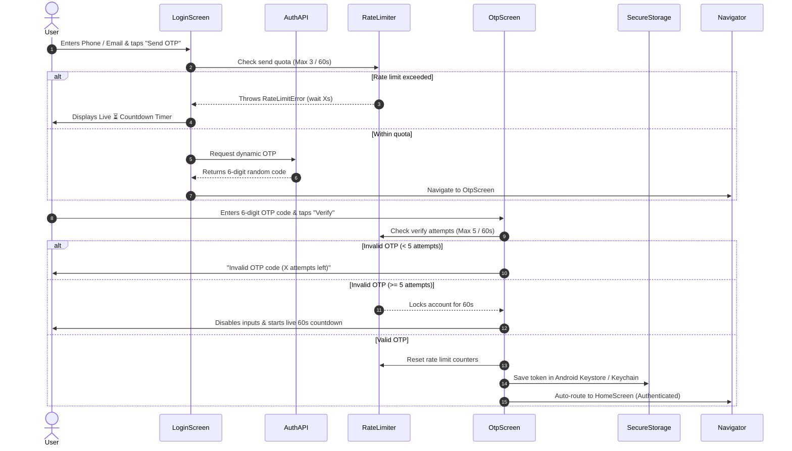

# My React Native Project

## Versions

- React Native: `0.88.1`
- Node.js: `v24.13.0`
- NPM: `11.6.2`

## Project Description

This is a robust, responsive React Native application for secure OTP authentication featuring client-side rate limiting, lockout countdowns, and cross-device adaptability.

## Features

- Mobile number login (+91 prefix, 10-digit validation)
- Email authentication (RFC regex validation)
- Dynamic random 6-digit OTP generation
- 1-click OTP clipboard copy & quick paste banner
- 6-box responsive OTP input with auto-focus & backspace navigation
- Inline attempt warnings (`(4 attempts left)`)
- "Too Many Attempts" rate limiting with live 60-second lockout countdown (`⏳ Try again in Xs`)
- Resend OTP with 30-second cooldown timer
- Data masking and privacy (`+91 *******736`, `j******e@example.com`)
- Hardware-backed encrypted token storage (`react-native-keychain`)
- Protected Home screen dashboard with logout functionality
- Cross-device responsiveness (adaptive for small screens, phablets, landscape, and tablets)
- Multi-architecture Android build support (`arm64-v8a`, `armeabi-v7a`, `x86_64`)

## Tech Stack

- **Framework:** React Native `0.88.1`
- **Language:** TypeScript
- **Navigation:** `@react-navigation/native`, `@react-navigation/native-stack`
- **Security:** `react-native-keychain`
- **Responsive Layout:** `react-native-safe-area-context`, `react-native-screens`
- **Testing:** Jest

## Installation & Running

**1. Clone the repository**

```bash
git clone <repository-url>
cd otpverifyapp
```

**2. Install dependencies**

```bash
npm install
```

**3. Start Metro bundler**

```bash
npx react-native start
```

**4. Run on Android (Emulator or Physical Device)**

```bash
npx react-native run-android
```

---

# Architecture & System Design

The application follows a **Feature-Driven Modular Layered Architecture** with strict separation of concerns, unidirectional data flow, and isolated service layers.



### 1. Layered Separation of Concerns

```text
┌────────────────────────────────────────────────────────┐
│ 1. Presentation Layer (UI / Views)                     │
│    LoginScreen, OtpScreen, HomeScreen, OtpInput, Button│
├────────────────────────────────────────────────────────┤
│ 2. State & Navigation Layer                            │
│    RootNavigator, AuthContext, useOtpTimer, Responsive │
├────────────────────────────────────────────────────────┤
│ 3. Domain & API Layer                                  │
│    authApi, otpApi                                     │
├────────────────────────────────────────────────────────┤
│ 4. Service & Security Layer                            │
│    RateLimiter (Sliding Window), SecureStorage         │
├────────────────────────────────────────────────────────┤
│ 5. Foundation / Utilities                              │
│    Validation, Masking, Logging, Clipboard             │
└────────────────────────────────────────────────────────┘
```

* **Presentation Layer (`src/features/*/screens`, `src/components/`):** Purely renders responsive UI widgets and handles touch interactions. Uses `KeyboardAvoidingView` and `ScrollView` to prevent keyboard occlusion across orientations.
* **State & Navigation Layer (`src/context/`, `src/navigation/`):** `AuthContext` provides global session state, while `RootNavigator` switches seamlessly between `AuthNavigator` and `AppNavigator` based on token presence.
* **Domain & API Layer (`src/features/*/api/`):** Encapsulates feature APIs (`authApi`, `otpApi`), orchestrates dynamic OTP generation, and integrates call logging.
* **Service & Security Layer (`src/services/`):** Houses cross-cutting services such as the in-memory **Sliding Window RateLimiter** (with live retry calculations) and `SecureStorage` (hardware-backed keystore integration).
* **Utilities Layer (`src/utils/`):** Pure deterministic utility modules for input validation, identifier masking, clipboard access, and responsive scaling calculations (`useResponsive`).

---

### 2. Directory Structure Architecture

```text
otpverifyapp/
├── android/                   # Native Android configuration (AGP 8.9+, Keystore, Proguard)
├── src/
│   ├── components/            # Reusable core UI widgets (Button, etc.)
│   ├── constants/             # Design tokens & color palettes
│   ├── context/               # Global React Context providers (AuthContext)
│   ├── features/              # Feature modules (auth, otp, home)
│   │   ├── auth/              # Login flow & credential handling
│   │   ├── otp/               # 6-box input, countdown timer, verify API
│   │   └── home/              # Protected post-login screen
│   ├── navigation/            # Navigation container & Stack navigators
│   ├── services/              # Infrastructure services (RateLimiter, SecureStorage)
│   ├── types/                 # Shared TypeScript interfaces
│   └── utils/                 # Pure utilities (Validation, Masking, Responsive)
└── __tests__/                 # Automated Jest test suites (Flows 1-4)
```

---

### 3. End-to-End Authentication & Security Flow



---

### 4. Key Architectural Pillars

* 🔒 **Security & Privacy by Design:** In-memory sliding-window rate limiting prevents brute-force abuse; PII masking hides telephone numbers (`+91 *******736`) and email addresses (`j******e@example.com`); JWT session tokens are stored in hardware-backed encrypted keystores (`react-native-keychain`).
* 📱 **Adaptive Cross-Device Responsiveness:** Dynamic 6-box OTP input dimensions calculate based on screen width via `useWindowDimensions()`, avoiding clipping on small screens (e.g. 320px) and overstretching on tablets. Large screens and tablets use a centered card layout (`maxWidth: 500`).
* ⚙️ **Multi-ABI Android Build Pipeline:** Configured with `reactNativeArchitectures=arm64-v8a,armeabi-v7a,x86_64` to bundle native C++ Hermes binaries simultaneously for **PC Emulators** (`x86_64`) and **Physical Phones** (`arm64-v8a`).

---

# Test Cases Summary (Flow 1 to Flow 4)

## Flow 1: Input Validation & Authentication Flow

**TC-VAL-01: Valid Mobile Number**
- Input: `9876543210`
- Expected Behavior: System accepts input, enables Send OTP button and proceeds without validation errors.

**TC-VAL-02: Invalid Phone Numbers**
- Input: Empty string, `12345`, `98765432101`, `98765abcde`
- Expected Behavior: System rejects input and displays: "Please enter a valid 10-digit mobile number".

**TC-VAL-03: Valid Email Address**
- Input: `john.doe@example.com`, `user+test@sub.org`
- Expected Behavior: System validates email format and allows OTP request.

**TC-VAL-04: Invalid Email Address**
- Input: `plainaddress`, `user@`, `@example.com`
- Expected Behavior: System rejects input and displays: "Please enter a valid email address".

**TC-VAL-05: Numeric-Only Phone Input**
- Input: Letters and special characters.
- Expected Behavior: Automatically removes non-numeric characters and permits only digits (0-9).

**TC-VAL-06: Auto-Fill Demo Credentials**
- Input: Enable Auto-fill for testing checkbox.
- Expected Behavior: Automatically fills demo phone `9876543736` or email `john.doe@example.com` based on the active tab.

---

## Flow 2: Data Masking & Privacy Flow

**TC-MSK-01: Mobile Number Masking**
- Input: `9876543736`
- Expected Behavior: Displays `+91 *******736`, hiding sensitive digits while showing the last 3 digits.

**TC-MSK-02: Email Address Masking**
- Input: `john.doe@example.com`
- Expected Behavior: Displays `j******e@example.com`, masking middle username characters while keeping the domain visible.

**TC-MSK-03: Short / Edge-Case Identifiers**
- Input: Null, empty string, or 2-character strings.
- Expected Behavior: Handles values safely without UI crashes or blank screens.

---

## Flow 3: Too Many Attempts – Rate Limiting & Live Lockout Countdown Flow

**TC-RL-01: Normal Attempt Tracking**
- Trigger: Incorrect OTP attempts 1 to 4.
- Expected Behavior: Displays remaining attempts: "Invalid OTP code (4 attempts left)".

**TC-RL-02: Exceeding Maximum Verification Limit**
- Trigger: 5 failed OTP attempts within 60 seconds.
- Expected Behavior: Triggers RateLimitError and locks the user out for 60 seconds.

**TC-RL-03: Live Countdown Timer Banner**
- Trigger: Lockout state active.
- Expected Behavior: Displays warning banner: "Too Many Attempts. Please wait 60s (59s, 58s...) before trying again."

**TC-RL-04: UI Control Lockout State**
- Trigger: Lockout timer running.
- Expected Behavior: OTP input boxes are disabled. Verify Code button displays "Try again in Xs" and remains disabled.

**TC-RL-05: Automatic Unlock at 0s**
- Trigger: Countdown reaches 0 seconds.
- Expected Behavior: Lockout banner disappears automatically and OTP inputs and Verify Code button are re-enabled.

**TC-RL-06: OTP Resend Rate Limiting**
- Trigger: User clicks Resend OTP more than 3 times within 60 seconds.
- Expected Behavior: Resend button gets locked and follows the active rate-limit cooldown timer.

**TC-RL-07: Successful Verification Reset**
- Trigger: User enters correct OTP.
- Expected Behavior: Rate-limit counter resets to 0 for that identifier after successful login.

---

## Flow 4: Dynamic Random OTP Generation & Verification Flow

**TC-OTP-01: Random 6-Digit OTP Generation**
- Action: Request OTP on Login screen.
- Expected Behavior: Generates a cryptographically secure, unpredictable 6-digit numeric OTP.

**TC-OTP-02: On-Screen OTP Badge**
- Action: OTP screen mounts.
- Expected Behavior: Displays generated code in a dedicated badge: "Generated OTP: XXXXXX".

**TC-OTP-03: 1-Click Clipboard Copy**
- Action: Click OTP badge or Copy Code.
- Expected Behavior: Copies the 6-digit OTP to clipboard and displays "Copied ✓" feedback.

**TC-OTP-04: 1-Click Quick Paste Banner**
- Action: Click Quick Paste banner.
- Expected Behavior: Automatically fills all 6 OTP input boxes and focuses the last box.

**TC-OTP-05: Clear OTP Action**
- Action: Click Clear OTP button.
- Expected Behavior: Clears all 6 OTP digits and resets keyboard focus to the first input box.

**TC-OTP-06: Valid OTP Submission & Session Creation**
- Action: Enter matching 6-digit OTP and click Verify Code.
- Expected Behavior: Verifies OTP, generates secure authentication token, saves token in secure storage, and navigates to Home screen.
